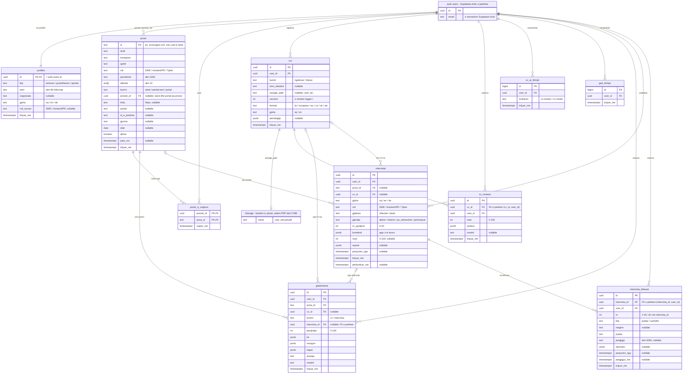

# Diagrami ER i bazës së të dhënave: si është bërë, si po bëhet, si menaxhohet dhe si do të duket në fund

*Kërkesë e Prof. Jakup Fondajt · 302-CSE, UMIB · Genti (@VocaDev) dhe Edoniku (@ed0n1k) · gjendja live më 14.11.2026*

Pjesët 2–5 janë kontrolluar në databazën live (vetëm lexim) dhe janë krahasuar me skedarët në `supabase/`. Pjesa 6 është plan: asgjë prej saj nuk është ndërtuar.

## 1. Hyrje

**Karriera** (Expo / React Native + Supabase) i tregon studentit të vitit të fundit **sa gati është për një punë konkrete** (përqindja, çka ka, çka i mungon) dhe e lë ta **praktikojë intervistën** për atë punë derisa të bëhet gati. Rrjedha ka pesë hapa (CV → Punët → "A jam gati?" → Intervista → Rezultatet), dhe secili hap ka tabelën e vet. Shumica e të dhënave janë personale (CV, përgjigje intervistash), prandaj modeli nis nga pyetja **"kush ka të drejtë ta shohë çka?"**.

## 2. Diagrami ER, sot

`PK` çelës primar, `FK` çelës i huaj, `UK` unik · `||` saktësisht një, `o|` zero ose një, `o{` zero ose shumë. `auth.users` është tabela e Supabase Auth (entitet i jashtëm); bucket-i `cv` në Storage shfaqet si shënim.

*Diagrami është kontrolluar me renderuesin zyrtar të Mermaid (i vlefshëm, lloji `er`). Si imazh: [docs/er/er-sot.svg](docs/er/er-sot.svg).*

Të 10 tabelat dhe bucket-i `cv` janë **live**; asnjë s'është në pritje. Gjendja e të dhënave: `punet` ka 19 shpallje të vërteta nga KosovaJob (`burimi = 'portal'`), 3 nga punëdhënësit dhe 6 shpallje fillestare të fshehura (`aktive = false`, jo të fshira); `profiles` 7 llogari (2 kërkues, 3 punëdhënës, 2 qendër); `cvs` 4; `cv_reviews` 1; tabelat e gatishmërisë dhe intervistës janë ende bosh.

- **FK të përbëra** `(…, user_id)` te `cv_reviews`, `intervista_kthesat` dhe `gatishmeria` garantojnë në bazë që një analizë, kthesë ose gatishmëri i përket të njëjtit përdorues si CV-ja ose intervista e vet.
- **Fshirja:** llogaria fshin gjithçka personale në kaskadë; fshirja e CV-së ose e punës e bën vetëm `null` lidhjen te intervistat, që historia të mbetet.
- **Rregullim i njohur:** live mungon kontrolli i vlerave të `punet.portali` (dy kontrolle me emrin `punet_portali_check`, i dyti e zëvendësoi të parin); e shtojmë me një migrim të vogël.

## 3. Si është bërë

- **`punet.id` është tekst:** id-të vijnë nga tri burime (`p1` te fillestaret, `kosovajob-1234` te portalet, uuid si tekst nga app-i). Kështu importi ditor bën `upsert` mbi të njëjtin çelës dhe nuk e shton dy herë të njëjtën shpallje.
- **`jsonb` për rezultatet e AI-së** (`analiza`, `raporti`, `vleresimi`, `ke`, `mungon`, `hapat`): forma ndryshon me promptin dhe s'do migrim. Vetëm numrat që renditen dhe krahasohen (`nota`, `perqindja`) janë `int` me `check (0–100)`.
- **Thirrjet e AI-së regjistrohen pa përmbajtje** (`cv_ai_thirrjet`, `gati_thirrjet`: vetëm kush dhe kur): mjafton për kufirin ditor, pa krijuar një kopje të dytë të CV-ve. Regjistrohen edhe kur dështojnë, dhe app-i s'ka asnjë leje mbi to.
- **CV-të në Storage privat:** bucket-i `cv` pranon vetëm PDF deri 5 MB, në dosjen `{user_id}/`; s'ka URL publike, dhe edhe Edge Functions e lexojnë PDF-në me JWT-në e përdoruesit.
- **Migrime SQL me dorë dhe me radhë:** jemi dy studentë në planin falas, pa CI. Çdo skedar thotë pas cilit ekzekutohet, mund të ekzekutohet disa herë pa dëm dhe ndalet vetë nëse i mungon një tabelë e nevojshme.
- **Telefoni nuk shkruan kurrë një notë** dhe historia s'mbishkruhet: `cvs` s'ka `update` (version i ri), `gatishmeria` shton një rresht për çdo llogaritje.

## 4. Si menaxhohet

### Kush mund të bëjë çka

Roli `anon` (pa hyrë) **s'ka asnjë leje**. "Të miat" = `user_id = auth.uid()`. Çelësi sekret (anashkalon RLS-in) jeton vetëm në Edge Functions.

| Tabela | SELECT | INSERT | UPDATE | DELETE | Shkruan serveri |
|---|---|---|---|---|---|
| `profiles` | i imi | trigger-i i regjistrimit | i imi: `emri`, `gjuha`, `roli_synuar` (ky vetëm për kërkuesin) | – | – |
| `punet` | kërkuesi: të gjitha; punëdhënësi, qendra: të vetat | punëdhënësi, qendra; vetëm `burimi = 'perdoruesi'` | të vetat, vetëm fushat e shpalljes | të vetat | `portalet` (rreshtat `portal`) |
| `punet_e_ruajtura` | të miat | kërkuesi | – | të miat | – |
| `cvs` + bucket `cv` | të miat | kërkuesi, në dosjen e vet | – | të miat | – |
| `cv_reviews` · `gatishmeria` · `intervistat` · `intervista_kthesat` | të miat (pa kolonat e brendshme `konteksti`, `perpunim_nga`) | – | – | – | `cv-review` · `gati`, `intervista-raporti` · `intervista-nis`, `-kthesa`, `-raporti` |
| `cv_ai_thirrjet` · `gati_thirrjet` | – | – | – | – | `cv-review`, `cv-create` · `gati` |

### Llojet e llogarive dhe kufijtë

- **`kerkues`** dhe **`punedhenes`** zgjidhen në regjistrim; **`qender`** jepet vetëm nga SQL Editor-i. Lloji ruhet te `profiles.lloji` (jo te metadata, që e ndryshon përdoruesi) dhe app-i s'ka leje ta ndryshojë.
- **`lloji_im()`** kthen llojin e përdoruesit të kyçur; e përdorin policy-të dhe Edge Functions (kush s'është `kerkues` merr 403). `numrat_e_qendres()` i jep qendrës vetëm katër totale, asnjë emër.
- **Kufijtë ditorë të AI-së** (numërohen në bazë, 429 pas kufirit): `cv-review` 5, `cv-create` 10, `gati` 10 në 24 orë; `intervista-nis` 3 intervista të reja.
- **Nuk ruhen kurrë:** teksti i plotë i shpalljeve (vetëm faktet, përmbledhja jonë dhe linku), zëri, video dhe fotot e intervistës, përmbajtja e thirrjeve të AI-së, çelësat, kontaktet e rekrutuesve.

### Rendi i migrimeve

| # | Skedari | Çka shton | Live |
|---|---|---|---|
| 1 | `migrations/20261104120000_punet.sql` | `punet` | po (SQL Editor, 04.11) |
| 2 | `j6-hyrja-rls.sql` | `profiles`, `lloji_im()`, `punet_e_ruajtura`, RLS | po (SQL Editor, 11.11) |
| 3 | `migrations/20261111000000_cv.sql` | `cvs`, `cv_reviews`, `cv_ai_thirrjet`, bucket `cv` | po |
| 4 | `migrations/20261114120000_punet_portalet.sql` | kolonat e portaleve te `punet` | po (14.11) |
| 5 | `migrations/20261115100000_profili_roli.sql` | `profiles.roli_synuar` | po (14.11) |
| 6 | `migrations/20261115110000_gatishmeria.sql` | `gatishmeria`, `gati_thirrjet` | po (14.11) |
| 7 | `migrations/20261115120000_intervistat.sql` | `intervistat`, `intervista_kthesat` | po (14.11) |
| – | `portalet-orari.sql` | importi ditor me `pg_cron` | jo ende (`pg_cron` s'është i instaluar) |

## 5. Çka po bëhet tani

Të gjitha migrimet e javës 14–15.11 janë live, dhe të shtatë Edge Functions janë aktive. Importi i parë nga portalet solli 19 shpallje nga KosovaJob; PortalPune e bllokoi serverin tonë (403) dhe nuk e anashkalojmë. Mbetet: prova nga fillimi në fund në telefon (CV → gatishmëria → intervista → raporti), orari ditor i importit dhe rregullimi i kontrollit të `portali`.

## 6. Si do të duket në fund (PLAN, jo i ndërtuar)

Nga **23.11**: **(A) të gjitha llojet e punëve** dhe **(B) qendra e karrierës si llogari e vërtetë**, ideja e Prof. Jakupit nga 04.11; pastaj zëri (09.12) dhe gjuha e trupit, streak-u dhe mësimi (13.01). Çdo element i ri ka etiketën `PLAN`.

*Diagrami është kontrolluar me renderuesin zyrtar të Mermaid (i vlefshëm, lloji `er`). Si imazh: [docs/er/er-ne-fund.svg](docs/er/er-ne-fund.svg).*

- **Kategoritë:** `kategorite` (Teknologji, Zyrë, Shitje, Hoteleri, Shëndetësi …) zëvendëson dy rolet e fiksuara; `udhezuesi` drejton pyetjet e intervistës për çdo kategori.
- **Qendra e karrierës:** `universitetet` (me domenin, p.sh. `umib.net`), `studentet_e_verifikuar` (i shkruan vetëm serveri pas verifikimit me email universitar), `partneret` dhe `raportet_e_qendres`. Praktikat dhe thirrjet e qendrës janë rreshta te `punet` me `universiteti_id`, të dukshme vetëm për studentët e atij universiteti.
- **"Sill linkun tënd":** `burimi = 'linku'`, puna duket vetëm për kërkuesin që e solli.
- **"Lëre AI-në të të njohë më mirë":** `njohja.pergjigjet` (`jsonb`, sepse pyetjet presin miratimin).
- **Zëri dhe gjuha e trupit:** `kohezgjatja_ms`, `metrikat` (vetëm numra) dhe `integriteti`; audio dhe video nuk ruhen.
- **Mësimi dhe streak-u:** `mesimet` (cache YouTube), `mesimi_progresi`, `ditet_aktive` (vetëm ditët me një veprim të vërtetë).

**Privatësia në fund.** Çdo rresht personal ka një pronar dhe vetëm ai e lexon. Qendra s'merr kurrë leje mbi tabelat personale: sheh vetëm grupe prej **të paktën 10** studentësh të verifikuar të universitetit të vet, përmes një funksioni që e zbaton këtë kufi në bazë. Statusi "student i verifikuar" dhe të gjitha notat i shkruan vetëm serveri.

## 7. Fjalorth

| Fjala | Kuptimi | Fjala | Kuptimi |
|---|---|---|---|
| `punet` | shpalljet e punës | `gatishmeria`, `perqindja` | sa gati je për një punë, në % |
| `profiles.lloji` | lloji i llogarisë | `ke` / `mungon` / `hapat` | çka ke, çka të mungon, hapat |
| `kerkues` · `punedhenes` · `qender` | kërkues pune · punëdhënës · qendër karriere | `intervistat`, `intervista_kthesat` | intervista dhe pyetjet e saj |
| `burimi` | prej nga erdhi rreshti | `vleresimi` | vlerësimi i një përgjigjeje |
| `pronari_id`, `user_id` | pronari i rreshtit | `thirrjet` | regjistri i thirrjeve të AI-së |
| `punet_e_ruajtura` | punët e ruajtura me ⭐ | `perpunim_nga` | "qiraja" kundër dërgimit të dyfishtë |
