# Diagrami ER i bazës së të dhënave: si është bërë, si po bëhet, si menaxhohet dhe si do të duket në fund

*Kërkesë e Prof. Jakup Fondajt · lënda 302-CSE Zhvillimi i Aplikacioneve Mobile, UMIB*
*Ekipi: Genti (@VocaDev) dhe Edoniku (@ed0n1k) · gjendja e kontrolluar më 14.11.2026*

**Si është kontrolluar ky dokument.** Çdo tabelë, kolonë, lidhje dhe leje në pjesët 2–5 është marrë nga databaza live në Supabase (vetëm lexim: `information_schema`, `pg_policies`, `pg_constraint`, historiku i migrimeve) dhe është krahasuar me skedarët SQL në `supabase/`. Ku diçka ekziston vetëm si skedar, ose vetëm si plan, kjo thuhet qartë. Asgjë në pjesën 6 nuk është ndërtuar ende.

---

## 1. Hyrje

**Karriera** është një aplikacion mobil (Expo / React Native, me Supabase si backend) për studentët e vitit të fundit dhe të sapodiplomuarit që kërkojnë praktikën ose punën e parë. Ai i tregon përdoruesit **sa gati është për një punë konkrete** (një përqindje, çka ka, çka i mungon dhe hapat për ta mbyllur boshllëkun) dhe e lë ta **praktikojë intervistën për atë punë** derisa të bëhet gati. Ne të dy jemi përdoruesit e parë, dhe bisedat me studentë na treguan pse duhet: njëri humbi katër muaj me një punë ku nuk do të aplikonte më, prandaj përshtatja duhet të dihet **para** aplikimit (`BISEDAT.md`).

**Pse pikërisht këto të dhëna.** Rrjedha e produktit ka pesë hapa (`HARTA.md`): CV-ja → Punët → "A jam gati?" → Intervista → Rezultatet. Çdo hap ka nevojë për një ose dy tabela, dhe asgjë më shumë: profili (kush je dhe çfarë llogarie ke), shpalljet e punës, CV-ja dhe analiza e saj, gatishmëria për një punë, intervista me pyetjet dhe përgjigjet. Pjesa më e madhe e këtyre të dhënave është **personale** (CV, përgjigje intervistash), prandaj modeli nuk nis nga pyetja "çka ruajmë?", por nga pyetja **"kush ka të drejtë ta shohë çka?"**. Kjo pyetje e ka formuar çdo tabelë më poshtë.

---

## 2. Diagrami ER, sot (live, 14.11.2026)

Shënimet në diagram: `PK` çelësi primar, `FK` çelësi i huaj, `UK` vlerë unike. Kardinalitetet: `||` saktësisht një, `o|` zero ose një, `o{` zero ose shumë. `auth.users` është tabela e Supabase Auth (entitet i jashtëm: e menaxhon platforma, ne vetëm lidhemi me të). Bucket-i `cv` në Storage nuk është tabelë: në diagram shfaqet si shënim, sepse lidhet me `cvs.storage_path`.

### Burimi i çdo tabele

Të gjitha tabelat e diagramit janë **live**. Asnjë tabelë nuk është "në pritje": migrimet e kësaj jave u aplikuan më 14.11 (shih 4.5). Numri i rreshtave është ai i 14.11 dhe tregon se jemi ende në fazën e provës.

| Tabela | Gjendja | Krijohet / ndryshohet nga | Rreshta (14.11) |
|---|---|---|---|
| `auth.users` | live | Supabase Auth (platforma) | – (një për çdo profil; nuk u numërua veçmas) |
| `profiles` | live | `supabase/j6-hyrja-rls.sql` · `supabase/migrations/20261115100000_profili_roli.sql` (`roli_synuar`) | 7 (2 kërkues, 3 punëdhënës, 2 qendër) |
| `punet` | live | `supabase/migrations/20261104120000_punet.sql` · `j6-hyrja-rls.sql` (`pronari_id`) · `20261114120000_punet_portalet.sql` (kolonat e portaleve) | 9 (6 `seed`, 3 `perdoruesi`, 0 `portal`) |
| `punet_e_ruajtura` | live | `j6-hyrja-rls.sql` | 0 |
| `cvs` | live | `20261111000000_cv.sql` | 4 (të gjitha PDF të ngarkuara) |
| bucket `cv` (Storage) | live | `20261111000000_cv.sql` | 4 skedarë |
| `cv_reviews` | live | `20261111000000_cv.sql` | 1 |
| `cv_ai_thirrjet` | live | `20261111000000_cv.sql` | 1 |
| `gatishmeria` | live | `20261115110000_gatishmeria.sql` · FK te `intervistat` nga `20261115120000_intervistat.sql` | 0 |
| `gati_thirrjet` | live | `20261115110000_gatishmeria.sql` | 0 |
| `intervistat` | live | `20261115120000_intervistat.sql` | 0 |
| `intervista_kthesat` | live | `20261115120000_intervistat.sql` | 0 |

Vetëm si skedar, **jo live**: `supabase/portalet-orari.sql` (orari ditor i importit me `pg_cron` + `pg_net`; të dy shtesat nuk janë ende të instaluara), dhe Edge Function `portalet` (nuk është deploy-uar). Prandaj `punet` ka kolonat e portaleve, por ende asnjë rresht `portal`.

### Çka nuk duket në diagram, por ka rëndësi

- **Çelësat e huaj të përbërë.** `cv_reviews (cv_id, user_id) → cvs (id, user_id)`, `intervista_kthesat (intervista_id, user_id) → intervistat (id, user_id)` dhe `gatishmeria (intervista_id, user_id) → intervistat (id, user_id)`. Kështu baza vetë e garanton që një analizë, një kthesë ose një gatishmëri i përket gjithmonë **të njëjtit përdorues** si CV-ja ose intervista e vet. Prandaj `cvs` dhe `intervistat` kanë edhe `unique (id, user_id)`.
- **Çka ndodh kur fshihet diçka.** Fshirja e llogarisë (`auth.users`) i fshin në kaskadë të gjitha të dhënat personale. Fshirja e një CV-je i fshin analizat e saj, por te `gatishmeria` dhe `intervistat` vetëm e bën `cv_id` null (historia mbetet). Fshirja e një pune i fshin ⭐ dhe gatishmërinë për të; te `intervistat` e bën `puna_id` null. Fshirja e një interviste e bën vetëm `intervista_id` null te `gatishmeria` (`on delete set null (intervista_id)`, pa e prekur `user_id`).
- **Trigger-at.** `kur_krijohet_llogaria` (te `auth.users`) krijon rreshtin te `profiles`; `cvs_versioni` llogarit `versioni` (v1, v2, …) për çdo përdorues.
- **Realtime.** `punet` është te publikimi `supabase_realtime`: puna e re i shkon kërkuesit menjëherë, me të njëjtin RLS.
- **Një vërejtje nga kontrolli live.** Migrimi i portaleve deklaron dy kontrolle me të njëjtin emër `punet_portali_check` (njërin te kolona `portali`, tjetrin mes fushave). I dyti e zëvendësoi të parin, prandaj live mungon kufizimi i vlerave të `portali` (`kosovajob / portalpune / ofertapune`). Rreziku është i vogël, sepse rreshtat `portal` i shkruan vetëm serveri, por do ta rregullojmë me një migrim të vogël.

---

## 3. Si është bërë: vendimet dhe arsyet

Baza u ndërtua në tri hapa, sipas javëve të lëndës: **04.11 (J5)** tabela `punet`; **11.11 (J6)** hyrja në llogari, rolet, RLS dhe CV-ja; **14.11** shpalljet nga portalet, roli i synuar, gatishmëria dhe intervista me tekst.

### 3.1 `punet.id` është tekst, jo uuid

Shpalljet vijnë nga tri burime dhe secili ka llojin e vet të identifikuesit: të dhënat fillestare kanë id të lexueshme (`p1` … `p6`), shpalljet e portaleve marrin id-në `<portali>-<id_e_jashtme>` (p.sh. `kosovajob-1234`), dhe shpalljet që shtohen nga app-i marrin `gen_random_uuid()::text`. Me id tekst, importi ditor bëhet `upsert` mbi të njëjtin çelës: e njëjta shpallje nuk shtohet dy herë, edhe nëse importi ekzekutohet përsëri. Id-ja përdoret edhe drejtpërdrejt në adresën e ekranit (`/pune/[id]`). Pasoja që e pranuam: çdo kolonë që tregon një punë (`punet_e_ruajtura.puna_id`, `gatishmeria.puna_id`, `intervistat.puna_id`) është gjithashtu `text`.

### 3.2 `jsonb` për rezultatet e AI-së

Analiza e CV-së (`cv_reviews.analiza`), raporti i intervistës (`intervistat.raporti`), vlerësimi i një përgjigjeje (`intervista_kthesat.vleresimi`) dhe listat e gatishmërisë (`ke`, `mungon`, `hapat`) janë struktura që ndryshojnë bashkë me promptin (analiza e CV-së është tashmë në versionin 2, me fushën `versioni` brenda JSON-it). Po t'i shpërndanim në dhjetëra kolona, çdo ndryshim i promptit do të kërkonte migrim. Rregulli që ndjekim: **AI-ja përgjigjet me structured output, Edge Function e kontrollon formën para se ta ruajë, dhe vetëm vlerat që i duhen bazës dalin në kolona të veta**: `nota` dhe `perqindja` janë `int` me `check (0–100)`, sepse renditen, krahasohen dhe më vonë do të numërohen në grup. Kështu baza e mbron numrin, ndërsa teksti shpjegues mbetet fleksibël.

### 3.3 Thirrjet e AI-së regjistrohen pa përmbajtje

`cv_ai_thirrjet` dhe `gati_thirrjet` kanë vetëm `user_id`, (`funksioni`) dhe `krijuar_me`. Kjo mjafton për të numëruar sa herë e ka thirrur dikush AI-në në 24 orët e fundit dhe për ta ndalur pas kufirit (pjesa 4.3). Përmbajtja (CV-ja, prompti, përgjigjja) nuk ruhet këtu me qëllim: një tabelë regjistrimi me përmbajtje do të ishte një kopje e dytë e CV-ve, pa asnjë arsye produkti. Thirrja regjistrohet **edhe kur dështon**, që kufiri të mos anashkalohet me riprovime. App-i nuk ka asnjë leje mbi këto tabela (RLS pa policy, pa `grant`), prandaj përdoruesi nuk mund ta fshijë numëruesin e vet.

### 3.4 CV-të në Storage privat

PDF-ja e CV-së ruhet në bucket-in `cv`, që është **privat**, pranon vetëm `application/pdf` dhe maksimumi 5 MB. Shtegu është `cv/{user_id}/{uuid}.pdf`, dhe policy-të e Storage lejojnë leximin, ngarkimin dhe fshirjen vetëm kur dosja e parë e shtegut është `auth.uid()`; ngarkimi kërkon edhe llojin `kerkues`. Nuk ka URL publike dhe nuk ka mbishkrim: çdo ngarkim është skedar i ri, pra version i ri. Rreshti te `cvs` e lidh skedarin me pronarin, dhe kontrolli `cvs_burimi_i_plote` kërkon që `storage_path` të nisë me `user_id` e rreshtit. Edhe Edge Functions e shkarkojnë PDF-në **me JWT-në e përdoruesit**, jo me çelësin sekret, kështu që RLS-i vlen edhe për serverin kur lexon CV-në.

### 3.5 Migrimet SQL, të aplikuara me dorë dhe me radhë

Jemi dy studentë në planin falas të Supabase, pa CI. Prandaj ndryshimet e bazës janë skedarë SQL në Git, që aplikohen me radhë (pjesa 4.5). Çdo skedar:

- e thotë në fillim **pas cilit skedar ekzekutohet** dhe **kush shkruan çka** në tabelat e veta;
- mund të ekzekutohet disa herë pa dëm (`create table if not exists`, `drop policy if exists` para `create policy`, kontrolle `if not exists` për constraint-et);
- ndalet vetë nëse mungon diçka që i duhet (p.sh. `20261115120000_intervistat.sql` jep gabim të qartë nëse mungon `gatishmeria`);
- shkruhet pasi e kemi lexuar gjendjen live (p.sh. `20261115100000_profili_roli.sql` shënon çka gjeti live më 14.11 para se ta ndryshojë).

Dy skedarët e parë (`20261104120000_punet.sql`, `j6-hyrja-rls.sql`) u ekzekutuan në SQL Editor dhe prandaj nuk janë në historikun e migrimeve të Supabase. Pesë të tjerët janë të regjistruar atje (pjesa 4.5).

### 3.6 Vendime të tjera që e mbajnë modelin të sigurt

- **Lloji i llogarisë jeton te `profiles.lloji`, jo te `user_metadata`.** Metadata-n e ndryshon vetë përdoruesi; kolonën `lloji` app-i nuk ka leje ta ndryshojë (lejet e kolonave). `qender` jepet vetëm nga SQL Editor-i.
- **Telefoni nuk shkruan kurrë një notë.** `cv_reviews`, `gatishmeria`, `intervistat` dhe `intervista_kthesat` nuk kanë asnjë leje shkrimi për app-in. Përndryshe kushdo do ta vendoste vetë "100%".
- **Historia ruhet, nuk mbishkruhet.** `cvs` nuk ka `update` (çdo ndryshim = version i ri) dhe `gatishmeria` shton një rresht për çdo llogaritje; app-i lexon më të renë. Kështu "62% → 70%" pas një interviste është i vërtetë dhe i kontrollueshëm.
- **"Qiraja" kundër dërgimit të dyfishtë.** `perpunim_nga` te `intervistat` dhe `intervista_kthesat` shënon që një kthesë ose një raport po përpunohet; një prekje e dytë e butonit nuk krijon dy pyetje ose dy raporte.
- **Asnjë filtër sigurie në telefon.** App-i i lexon "të miat" pa `.eq("user_id", …)`; RLS-i kthen vetëm rreshtat e lejuar. Ky mësim erdhi nga J6, kur një filtër në telefon la të dukshme punët e një punëdhënësi tjetër përmes API-t.

---

## 4. Si menaxhohet

### 4.1 Kush mund të bëjë çka, tabelë për tabelë

Të dhënat e marra live nga `pg_policies` dhe `information_schema.role_table_grants` / `column_privileges`. Roli `anon` (pa hyrë në llogari) **nuk ka asnjë leje në asnjë tabelë**. "Vetëm të vetat" do të thotë `user_id = auth.uid()` (ose `id` / `pronari_id`). Edge Functions përdorin çelësin sekret vetëm për shkrimet e shënuara në kolonën e fundit; çelësi sekret anashkalon RLS-in dhe nuk ndodhet kurrë në app.

| Tabela | SELECT | INSERT | UPDATE | DELETE | Kush shkruan nga serveri |
|---|---|---|---|---|---|
| `profiles` | vetëm profili im | askush nga app-i: e krijon trigger-i `krijo_profilin` | vetëm profili im, vetëm `emri`, `gjuha`, `roli_synuar`; `roli_synuar` vetëm nëse `lloji = 'kerkues'` | askush (fshihet në kaskadë me llogarinë) | asnjë funksion; `gati` dhe `intervista-nis` e lexojnë me JWT-në e përdoruesit |
| `punet` | kërkuesi: të gjitha; punëdhënësi dhe qendra: vetëm të vetat | punëdhënësi dhe qendra, vetëm në emrin e vet, vetëm `burimi = 'perdoruesi'` | vetëm të vetat, vetëm fushat e shpalljes (`titulli`, `kompania`, `qyteti`, `roli`, `pershkrimi`, `aftesite`) | vetëm të vetat | `portalet` (rreshtat `portal`; ende pa deploy); `gati` dhe `intervista-nis` lexojnë me JWT |
| `punet_e_ruajtura` | vetëm të miat | vetëm kërkuesi, vetëm në emrin e vet | askush | vetëm të miat | asnjë |
| `cvs` | vetëm të miat | vetëm kërkuesi, vetëm kolonat `burimi`, `emri_skedarit`, `storage_path`, `formati`, `gjuha`, `permbajtja` (`user_id` dhe `versioni` i vendos serveri) | askush (version i ri në vend të ndryshimit) | vetëm të miat | asnjë; `cv-review`, `gati`, `intervista-nis` lexojnë me JWT |
| bucket `cv` | vetëm dosja ime | vetëm kërkuesi, vetëm te dosja ime | askush | vetëm dosja ime | `cv-review` dhe `gati` e shkarkojnë me JWT |
| `cv_reviews` | vetëm të miat | askush nga app-i | askush | askush (kaskadë me CV-në) | `cv-review` |
| `cv_ai_thirrjet` | askush | askush | askush | askush | `cv-review`, `cv-create` |
| `gatishmeria` | vetëm të miat | askush nga app-i | askush | askush | `gati` (`burimi = 'cv'`), `intervista-raporti` (`burimi = 'intervista'`) |
| `gati_thirrjet` | askush | askush | askush | askush | `gati` |
| `intervistat` | vetëm të miat, pa kolonat `user_id`, `konteksti`, `perpunim_nga` | askush nga app-i | askush | askush | `intervista-nis`, `intervista-kthesa`, `intervista-raporti` |
| `intervista_kthesat` | vetëm të miat, pa kolonat `user_id`, `perpunim_nga` | askush nga app-i | askush | askush | `intervista-nis`, `intervista-kthesa`, `intervista-raporti` |

Rregullat i provon `scripts/test-rls.mjs` (34 rregulla që nga J6, vetëm me çelësin publik, si të ishte një sulmues), p.sh. "Punëdhënësi 2 s'i sheh punët e punëdhënësit 1".

### 4.2 Llojet e llogarive dhe `lloji_im()`

| Lloji | Çka bën sot | Si merret |
|---|---|---|
| `kerkues` | lexon të gjitha punët, ruan ⭐, ngarkon CV, merr gatishmërinë, praktikon intervistën | zgjidhet në regjistrim (çdo gjë që s'është punëdhënës) |
| `punedhenes` | poston punë; sheh, ndryshon dhe fshin vetëm të vetat | zgjidhet në regjistrim |
| `qender` | si punëdhënësi, plus numrat e përgjithshëm përmes `numrat_e_qendres()` (vetëm katër totale, asnjë emër) | **vetëm** nga SQL Editor-i, kurrë nga app-i |

`public.lloji_im()` është një funksion i vogël SQL që kthen `lloji` e përdoruesit të kyçur, duke lexuar vetëm rreshtin e tij te `profiles`. Të gjitha policy-të që varen nga lloji e thërrasin atë (p.sh. `punet_lexo`, `cvs_shto_own`), dhe Edge Functions e thërrasin si hapin e dytë të kontrollit (pas sesionit): kush s'është `kerkues` merr 403. `numrat_e_qendres()` është `security definer` me qëllim: numëron të gjitha rreshtat, por kthen vetëm totale dhe refuzon çdo llogari që s'është `qender`.

### 4.3 Kufijtë ditorë të AI-së

Çdo thirrje e AI-së kushton, prandaj secili funksion ka kufi për përdorues në 24 orët e fundit. Kufiri numërohet në bazë, jo në telefon.

| Funksioni | Kufiri | Ku numërohet |
|---|---|---|
| `cv-review` (analiza e CV-së) | 5 në 24 orë | `cv_ai_thirrjet` (`funksioni = 'cv-review'`) |
| `cv-create` (CV nga 5 përgjigje) | 10 në 24 orë | `cv_ai_thirrjet` (`funksioni = 'cv-create'`) |
| `gati` ("A jam gati?") | 10 në 24 orë | `gati_thirrjet` |
| `intervista-nis` | 3 intervista të reja në 24 orë | vetë `intervistat` (`krijuar_me`) |

Pas kufirit funksioni kthen 429 me një fjali në shqip ("Ke arritur kufirin … Provo përsëri nesër."). Kthesat dhe raporti i një interviste të nisur nuk numërohen veçmas: kufizohen nga `nr_pyetjeve` (0–20) dhe `nr` (1–40).

### 4.4 Çka nuk ruhet kurrë

Nga `MODELI.md` dhe komentet në migrime:

- **Teksti i plotë i shpalljeve nga portalet.** Ruhen vetëm faktet (titulli, kompania, qyteti, roli, afati, aftësitë), një përmbledhje me fjalët tona dhe linku te burimi. Email-et dhe telefonat e rekrutuesve nuk merren.
- **Zëri dhe video e intervistës.** Ruhen vetëm teksti, notat dhe feedback-u. Edhe kur të vijë intervista me zë (09.12), audio dhe video nuk ruhen.
- **Përmbajtja e thirrjeve të AI-së në regjistra.** Vetëm kush dhe kur (3.3). Asnjë funksion nuk e shkruan CV-në, pyetjet ose përgjigjet në log.
- **Çelësat** (i bazës, i AI-së): as në tabela, as në repo, as në app; vetëm në sekretet e Edge Functions dhe në `.env` lokal.
- **Lloji i llogarisë në metadata** të përdoruesit: vetëm te `profiles`.
- **Konteksti i intervistës** (`intervistat.konteksti`) mban një përmbledhje të CV-së pa emër, email ose telefon, dhe app-i nuk e lexon.

### 4.5 Rendi i migrimeve

| # | Skedari | Çka bën | Live |
|---|---|---|---|
| 1 | `supabase/migrations/20261104120000_punet.sql` | `punet` + 6 shpallje fillestare | po, me dorë në SQL Editor (04.11) |
| 2 | `supabase/j6-hyrja-rls.sql` | `profiles`, `lloji_im()`, trigger-i i regjistrimit, `pronari_id`, `punet_e_ruajtura`, `numrat_e_qendres()`, RLS, Realtime | po, me dorë në SQL Editor (11.11) |
| 3 | `supabase/migrations/20261111000000_cv.sql` | `cvs`, `cv_reviews`, `cv_ai_thirrjet`, bucket-i `cv` | po (historiku: `20261111132616 cv`) |
| 4 | `supabase/migrations/20261114120000_punet_portalet.sql` | kolonat e portaleve te `punet` | po (historiku: `20261114202420 punet_portalet`) |
| 5 | `supabase/migrations/20261115100000_profili_roli.sql` | `profiles.roli_synuar`, lejet e kolonave | po (historiku: `20261114202454 profili_roli`) |
| 6 | `supabase/migrations/20261115110000_gatishmeria.sql` | `gatishmeria`, `gati_thirrjet` | po (historiku: `20261114202514 gatishmeria`) |
| 7 | `supabase/migrations/20261115120000_intervistat.sql` | `intervistat`, `intervista_kthesat`, FK nga `gatishmeria` | po (historiku: `20261114202545 intervistat`) |
| – | `supabase/portalet-orari.sql` | orari ditor i importit (pg_cron) | **jo**: pret deploy-in e `portalet` |

Data në emrin e skedarit tregon kur u shkrua migrimi; versioni në historik tregon kur u aplikua. Renditja ka rëndësi: 2 kërkon 1, 3 kërkon `lloji_im()` nga 2, 6 kërkon `punet` dhe `cvs`, 7 kërkon `gatishmeria`.

---

## 5. Çka po bëhet tani (java 14–15.11)

Puna e kësaj jave u ndërtua në shtatë degë dhe u bashkua në degën `claude/integrimi-java-c0810e`. Ana e bazës është **live që nga 14.11**; ajo që mbetet është prova nga fillimi në fund në telefon.

| Ndryshimi | Skedari | Baza (14.11) | Edge Function | Çka mbetet |
|---|---|---|---|---|
| Shpalljet e vërteta nga KosovaJob dhe PortalPune: `punet.linku`, `portali`, `id_e_jashtme`, `gjurma`, `afati`, `aktive`, `pare_me`, `burimi = 'portal'` | `20261114120000_punet_portalet.sql` | live, 0 rreshta `portal` | `portalet`: **pa deploy** | deploy, importi i parë, pastaj `portalet-orari.sql`; pëlqimi me shkrim nga PortalPune; rregullimi i kontrollit të `portali` (pjesa 2) |
| Roli i synuar dhe gjuha e intervistës: `profiles.roli_synuar` | `20261115100000_profili_roli.sql` | live | – | ekrani i zgjedhjes pas regjistrimit |
| "A jam gati?": `gatishmeria`, `gati_thirrjet` | `20261115110000_gatishmeria.sql` | live, 0 rreshta | `gati` v1 aktiv | prova e parë me një CV dhe një punë të vërtetë |
| Intervista me tekst: `intervistat`, `intervista_kthesat` | `20261115120000_intervistat.sql` | live, 0 rreshta | `intervista-nis`, `intervista-kthesa`, `intervista-raporti` aktive | prova e parë nga fillimi te raporti dhe gatishmëria e re |

Analiza e CV-së (`cv-review`, versioni 5 i funksionit) ka përfunduar tashmë një herë live (1 rresht te `cv_reviews`).

---

## 6. Si do të duket në fund (PLAN, jo i ndërtuar)

Nga **23.11** aplikacioni zgjerohet në dy drejtime që i vendosi Genti më 14.11: **(A) të gjitha llojet e punëve**, jo vetëm SWE dhe Asistent/PR, dhe **(B) qendra e karrierës si llogari e vërtetë**, ideja që Prof. Jakupi e propozoi më 04.11. Pas tyre vijnë pjesët e HARTA-s për 09.12 (zëri) dhe 13.01 (gjuha e trupit, streak, mësimi). **Asnjë nga tabelat dhe kolonat më poshtë nuk ekziston.** Emrat janë propozime dhe vendosen përfundimisht kur të shkruhet migrimi. Në diagram, çdo element i ri ka etiketën `PLAN`; tabelat ekzistuese shfaqen vetëm me kolonat kryesore.

```mermaid
erDiagram
    auth_users["auth.users"] {
        uuid id PK
    }
    profiles {
        uuid id PK, FK
        text lloji "kerkues / punedhenes / qender"
        text kategoria_synuar FK "PLAN, ne vend te roli_synuar"
        uuid universiteti_id FK "PLAN, per llogarine qender"
    }
    punet {
        text id PK
        text burimi "seed / perdoruesi / portal / PLAN: linku"
        text kategoria_id FK "PLAN, ne vend te roli"
        text lloji_shpalljes "PLAN: pune / praktike / thirrje / burse / projekt"
        uuid universiteti_id FK "PLAN, null = publike"
        uuid pronari_id FK
        text linku
    }
    cvs {
        uuid id PK
        uuid user_id FK
    }
    gatishmeria {
        uuid id PK
        text puna_id FK
        int perqindja
    }
    intervistat {
        uuid id PK
        text puna_id FK
        text kategoria_id FK "PLAN"
        int integriteti "PLAN, 0-100 me arsye"
        jsonb raporti
    }
    intervista_kthesat {
        uuid id PK
        uuid intervista_id FK
        text pergjigja "teksti ose transkripti"
        int kohezgjatja_ms "PLAN"
        jsonb metrikat "PLAN, vetem numra"
    }
    kategorite["PLAN: kategorite"] {
        text id PK "teknologji, zyre, shitje, hoteleri ..."
        text emri
        int renditja
        jsonb udhezuesi "pyetjet dhe kompetencat e kategorise"
    }
    universitetet["PLAN: universitetet"] {
        uuid id PK
        text emri
        text domeni UK "p.sh. umib.net"
        timestamptz krijuar_me
    }
    studentet_e_verifikuar["PLAN: studentet_e_verifikuar"] {
        uuid user_id PK, FK
        uuid universiteti_id FK
        text njesia "fakulteti, nullable"
        timestamptz verifikuar_me
    }
    partneret["PLAN: partneret"] {
        uuid universiteti_id PK, FK
        uuid punedhenesi_id PK, FK
        text gjendja "ftuar / pranuar"
        timestamptz krijuar_me
    }
    raportet_e_qendres["PLAN: raportet_e_qendres"] {
        uuid id PK
        uuid universiteti_id FK
        date nga
        date deri
        jsonb numrat "vetem grupe me min. 10 studente"
        timestamptz krijuar_me
    }
    numrat_e_grupit["PLAN: funksioni numrat_e_universitetit, jo tabele"] {
        text grupi "fakulteti / viti / kategoria"
        int studentet "kthehet vetem kur jane min. 10"
        int gatishmeria_mesatare
    }
    njohja["PLAN: njohja"] {
        uuid user_id PK, FK
        jsonb pergjigjet "pyetjet e onboarding-ut"
        timestamptz perditesuar_me
    }
    mesimet["PLAN: mesimet"] {
        uuid id PK
        text aftesia
        text video_id "YouTube"
        text titulli
        text gjuha
        timestamptz ruajtur_me
    }
    mesimi_progresi["PLAN: mesimi_progresi"] {
        uuid user_id PK, FK
        uuid mesimi_id PK, FK
        timestamptz perfunduar_me
    }
    ditet_aktive["PLAN: ditet_aktive"] {
        uuid user_id PK, FK
        date dita PK
        text veprimi "intervista / mesim / gatishmeri"
    }

    auth_users ||--|| profiles : "ka profilin"
    auth_users ||--o{ cvs : "ngarkon"
    auth_users |o--o{ punet : "poston ose sjell linkun"
    punet ||--o{ gatishmeria : "per punen"
    punet |o--o{ intervistat : "per punen"
    intervistat ||--o{ intervista_kthesat : "ka kthesat"
    kategorite ||--o{ punet : "PLAN"
    kategorite |o--o{ profiles : "PLAN synon"
    kategorite |o--o{ intervistat : "PLAN"
    universitetet |o--o{ profiles : "PLAN qendra e tij"
    universitetet ||--o{ studentet_e_verifikuar : "PLAN verifikon"
    auth_users ||--o| studentet_e_verifikuar : "PLAN"
    universitetet |o--o{ punet : "PLAN poston per studentet e vet"
    universitetet ||--o{ partneret : "PLAN fton"
    auth_users ||--o{ partneret : "PLAN punedhenesi"
    universitetet ||--o{ raportet_e_qendres : "PLAN"
    universitetet ||--o{ numrat_e_grupit : "PLAN lexon vetem grupe"
    auth_users ||--o| njohja : "PLAN"
    mesimet ||--o{ mesimi_progresi : "PLAN"
    auth_users ||--o{ mesimi_progresi : "PLAN"
    auth_users ||--o{ ditet_aktive : "PLAN"
```

### 6.1 Kategoritë për të gjitha llojet e punëve (A)

Sot `punet.roli` dhe `profiles.roli_synuar` lejojnë vetëm `SWE`, `Asistent/PR` (dhe `Tjetër` te punët). Importi nga KosovaJob pa më 14.11 409 shpallje dhe mbajti vetëm 27, sepse të tjerat s'kishin rol. Plani: një tabelë e vogël **`kategorite`** (p.sh. Teknologji · Zyrë/Administratë · Shitje & klientë · Hoteleri · Shëndetësi · Arsim · Teknikë/Ndërtim · Siguri · Tjetër), e lexueshme nga të gjithë dhe e shkruar vetëm nga ne. `punet.kategoria_id`, `profiles.kategoria_synuar` dhe `intervistat.kategoria_id` bëhen çelësa të huaj në vend të listave të fiksuara në `check`. `udhezuesi` mban kompetencat dhe llojet e pyetjeve për kategorinë, kështu që intervista drejtohet nga teksti i shpalljes plus udhëzuesi, jo nga një prompt për çdo rol. Gjatë kalimit, `roli` mbetet derisa app-i të lexojë kategorinë. Një shënim i ndershëm: punët shtetërore me provim (p.sh. policia) do të kenë vetëm përgatitje të përgjithshme; app-i do ta thotë këtë.

### 6.2 Qendra e karrierës (B)

Sot `qender` ekziston si lloj llogarie, por `numrat_e_qendres()` kthen totale **globale** (të gjithë përdoruesit, jo sipas universitetit). Plani, sipas ekraneve 96–102 të bordit të dizajnit:

- **`universitetet`**: një rresht për çdo universitet, me `domeni` unik (`umib.net`). Llogaria `qender` lidhet me një universitet përmes `profiles.universiteti_id`.
- **`studentet_e_verifikuar`**: studenti verifikohet me email-in universitar (kod i dërguar te `@umib.net`). Rreshtin e shkruan **vetëm serveri** pas verifikimit, kurrë app-i, që askush të mos e shpallë veten student i një universiteti.
- **Numra vetëm në grup.** Qendra nuk merr leje `select` mbi asnjë tabelë personale. I lexon numrat përmes një funksioni `security definer` (`numrat_e_universitetit()`) që grupon studentët e verifikuar të universitetit të vet (sipas fakultetit, vitit ose kategorisë) dhe **nuk kthen asnjë grup me më pak se 10 studentë**. Kjo është rregull në bazë, jo premtim në ekran.
- **Postimet për studentët e vet** (praktikë, thirrje, bursë, projekt): ripërdorin `punet`, me `universiteti_id` dhe `lloji_shpalljes`. Policy-ja e leximit bëhet: kërkuesi sheh shpalljet publike (`universiteti_id` null) dhe ato të universitetit ku është i verifikuar. Kështu "A jam gati?" dhe intervista punojnë edhe për një praktikë të universitetit, pa tabelë të re. Kolona `lloji_shpalljes` e zgjidh edhe dallimin praktikë / punë që mungon sot.
- **`partneret`**: punëdhënësit që qendra i fton. Rreshti krijohet nga qendra dhe pranohet nga punëdhënësi (`gjendja`).
- **`raportet_e_qendres`**: raporti i punësueshmërisë për një periudhë (p.sh. semestri). `numrat` mban vetëm numra të grumbulluar nga funksioni i mësipërm; PDF-ja gjenerohet nga ky rresht dhe nuk përmban asnjë emër.

### 6.3 "Sill linkun tënd"

Kërkuesi ngjit linkun e një shpalljeje që e ka gjetur vetë. Një Edge Function (`sill-linkun`) e lexon faqen dhe ruan te `punet` vetëm faktet, një përmbledhje me fjalët tona dhe `linku`, me `burimi = 'linku'` dhe `pronari_id` = kërkuesi. Ky rresht duket **vetëm për pronarin** (ndryshim te policy `punet_lexo`), por ka të njëjtin `id` si çdo punë tjetër, prandaj gatishmëria dhe intervista funksionojnë pa ndryshim. Për LinkedIn, që nuk lexohet automatikisht, rruga është një screenshot që e lexon AI-ja; screenshot-i nuk ruhet.

### 6.4 "Lëre AI-në të të njohë më mirë"

Pas zgjedhjes së kategorisë dhe gjuhës, disa pyetje të shkurtra dhe opsionale (niveli, çka kërkon, qyteti, tri aftësitë kryesore, çka të shqetëson në intervistë, sa kohë ke në javë). Pyetjet presin miratimin e Gentit, prandaj përgjigjet ruhen te **`njohja.pergjigjet`** si `jsonb` dhe jo në kolona. RLS: secili lexon dhe ndryshon vetëm të vetat. Përdoren vetëm nga `gati` dhe `intervista-*` për t'i përshtatur pyetjet dhe këshillat, dhe ekrani e thotë këtë me një fjali.

### 6.5 Zëri dhe gjuha e trupit në intervistë

Me intervistën me zë dhe avatar (09.12) dhe gjuhën e trupit (13.01), çdo kthesë merr **`kohezgjatja_ms`** dhe **`metrikat`**: vetëm numra që llogariten në telefon me MediaPipe (kontakti me sy %, buzëqeshja %, qëndrueshmëria e kokës, pa fytyrë / dy fytyra). Intervista merr **`integriteti`** (0–100), me arsyet në `raporti`; është sinjal, kurrë akuzë. Transkripti i zërit shkon te `pergjigja`, si përgjigjet me tekst sot. **Audio, video dhe fotot nuk ruhen asnjëherë.**

### 6.6 Mësimi dhe streak-u

- **`mesimet`**: cache e përbashkët "aftësi → video YouTube", që të mos e thërrasim API-n e YouTube për çdo përdorues. Lexim për të gjithë, shkrim vetëm nga serveri.
- **`mesimi_progresi`**: cilin mësim e ka përfunduar kërkuesi; vetëm të vetat.
- **`ditet_aktive`**: një rresht për çdo ditë kur kërkuesi ka bërë një veprim të vërtetë (ka mbaruar një intervistë, një mësim, ka marrë gatishmërinë). E shkruan serveri, kur veprimi përfundon; streak-u = ditët e njëpasnjëshme. Asnjë pikë pa veprim pas saj.

### 6.7 Si mbetet privatësia në gjendjen përfundimtare

Edhe me tri llojet e llogarive dhe me universitetin brenda app-it, rregulli mbetet i njëjtë si sot: **çdo rresht personal ka një pronar dhe vetëm pronari e lexon**. Punëdhënësi sheh vetëm shpalljet e veta dhe partneritetet e veta. Qendra e karrierës nuk merr kurrë leje mbi tabelat personale: sheh vetëm grupe prej të paktën 10 studentësh të verifikuar të universitetit të vet, përmes një funksioni që e zbaton këtë kufi në bazë. Statusi "student i verifikuar" dhe të gjitha notat (CV, gatishmëri, intervistë, integritet) i shkruan vetëm serveri. Zëri, video, fotot dhe teksti i plotë i shpalljeve nuk ruhen. Fshirja e llogarisë fshin në kaskadë gjithçka personale, ndërsa raportet e qendrës mbeten sepse nuk kanë asnjë të dhënë individuale.

---

## 7. Fjalorth

**Tabelat**

| Emri | Kuptimi |
|---|---|
| `profiles` | profili: një rresht për çdo llogari |
| `punet` | shpalljet e punës |
| `punet_e_ruajtura` | punët që kërkuesi i ka ruajtur me ⭐ |
| `cvs` | CV-të e kërkuesit, një rresht për çdo version |
| `cv_reviews` | analizat e CV-së nga AI-ja |
| `cv_ai_thirrjet` | regjistri i thirrjeve të AI-së për CV-në (për kufirin ditor) |
| `gatishmeria` | sa gati është kërkuesi për një punë (historia e llogaritjeve) |
| `gati_thirrjet` | regjistri i thirrjeve të funksionit `gati` (për kufirin ditor) |
| `intervistat` | intervistat praktike |
| `intervista_kthesat` | kthesat e një interviste: pyetja, përgjigjja, vlerësimi |

**Kolonat**

| Emri | Kuptimi |
|---|---|
| `lloji` (`profiles`) | lloji i llogarisë: `kerkues` (kërkues pune), `punedhenes` (punëdhënës), `qender` (qendër karriere) |
| `lloji` (`intervista_kthesat`) | `pyetje` (pyetje kryesore) ose `vazhdim` (pyetje vazhduese) |
| `emri` | emri i përdoruesit |
| `organizata` | emri i kompanisë ose i qendrës |
| `gjuha` | gjuha: `sq` shqip, `en` anglisht, `de` gjermanisht |
| `roli`, `roli_synuar` | roli i punës / roli që synon kërkuesi |
| `krijuar_me` | kur u krijua rreshti |
| `titulli`, `kompania`, `qyteti` | titulli i pozitës, kompania, qyteti |
| `pershkrimi` | përshkrimi i shkurtër i shpalljes |
| `aftesite` | aftësitë që kërkon shpallja |
| `burimi` | prejardhja: te `punet` `seed` / `perdoruesi` / `portal`; te `cvs` `ngarkuar` / `krijuar`; te `gatishmeria` `cv` / `intervista` |
| `pronari_id` | pronari i rreshtit (kush e postoi ose e ruajti) |
| `linku` | linku te shpallja origjinale |
| `portali` | portali nga erdhi shpallja |
| `id_e_jashtme` | id-ja e shpalljes te portali |
| `gjurma` | titulli + kompania të normalizuar, për të gjetur të njëjtën punë në dy portale |
| `afati` | afati i aplikimit |
| `aktive` | shpallja është ende e hapur |
| `pare_me` | herën e fundit kur importi e pa shpalljen |
| `puna_id` | puna me të cilën lidhet rreshti |
| `ruajtur_me` | kur u ruajt puna |
| `user_id` | pronari i rreshtit |
| `emri_skedarit` | emri i skedarit PDF |
| `storage_path` | shtegu i PDF-së në bucket-in `cv` |
| `versioni` | numri i versionit të CV-së (v1, v2, …) |
| `formati` | formati i CV-së (`ks` Kosovë, `europass`, `eu`, `us`, `uk`, `ats`) |
| `permbajtja` | përmbajtja e CV-së së krijuar në app, si JSON |
| `cv_id` | CV-ja me të cilën lidhet rreshti |
| `nota` | nota 0–100 |
| `analiza` | analiza e plotë e CV-së, si JSON |
| `modeli` | modeli i AI-së që e prodhoi rezultatin |
| `funksioni` | cili funksion e thirri AI-në |
| `perqindja` | gatishmëria në përqindje (0–100) |
| `ke` | çka ke tashmë, me dëshminë nga CV-ja |
| `mungon` | çka të mungon, pse dhe si ta mbyllësh |
| `hapat` | 1–3 hapa konkretë |
| `arsyeja` | pse pikërisht ky numër, në 1–2 fjali |
| `intervista_id` | intervista me të cilën lidhet rreshti |
| `gjatesia` | gjatësia e intervistës: `shkurter` ose `plote` |
| `gjendja` | gjendja e intervistës: `aktive`, `mbaroi`, `po_vleresohet`, `perfunduar` |
| `nr_pyetjeve` | sa pyetje kryesore janë bërë |
| `konteksti` | puna dhe përmbledhja e CV-së (pa të dhëna kontakti), e ngrirë në fillim |
| `raporti` | raporti përfundimtar i intervistës, si JSON |
| `perpunim_nga` | "qiraja": kur nisi përpunimi, kundër dërgimit të dyfishtë |
| `perfunduar_me` | kur përfundoi intervista |
| `nr` | numri rendor i kthesës |
| `reagimi` | reagimi i shkurtër i intervistuesit para pyetjes |
| `pyetja`, `pergjigja` | pyetja dhe përgjigjja |
| `vleresimi` | vlerësimi i përgjigjes: çka ishte mirë, çka të përmirësohet, një shembull |
| `pergjigjur_me` | kur u përgjigj kërkuesi |
